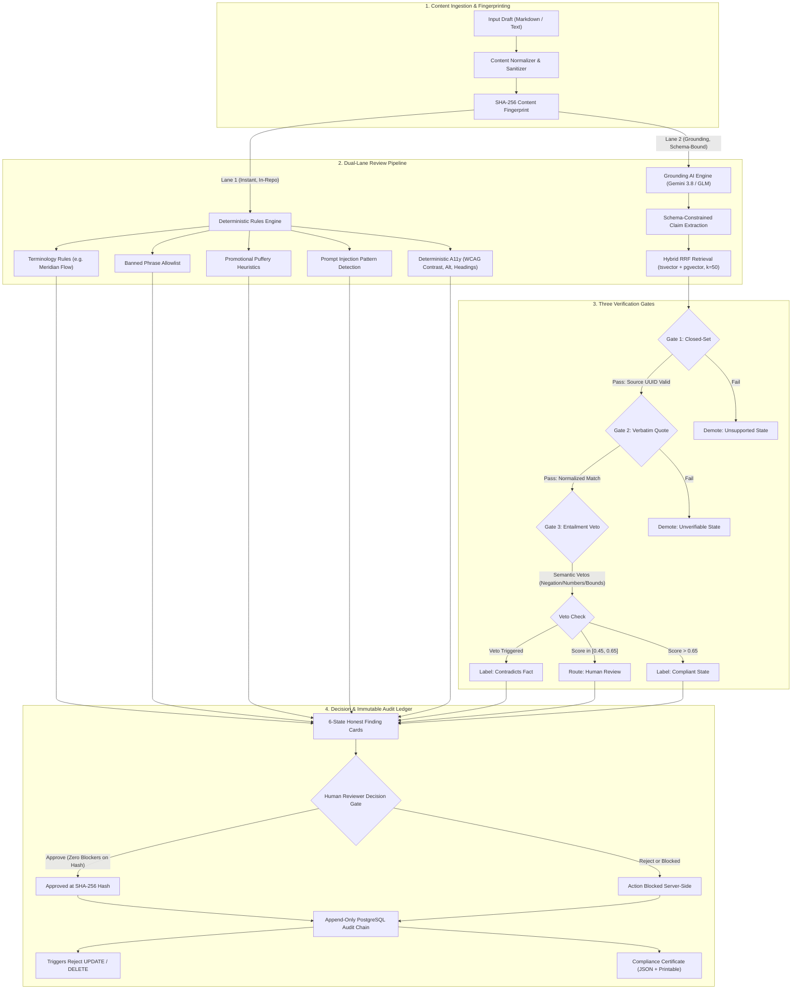

# Imprimatur

> **A pre-publication brand-governance review gate.** Drafts are evaluated against an organisation's own approved knowledge sources; every finding cites verifiable evidence; every approval is a cryptographic human decision bound to content hash; and all actions are recorded in an append-only, tamper-evident PostgreSQL audit chain.

[](https://imprimatur-eight.vercel.app)
[](https://github.com/hamsavartn/imprimatur)
[](tests/)
[-green?style=flat-square)](benchmark/)
[-blue?style=flat-square)](src/lib/retrieval/)
[](scripts/db-verify.ts)

---

## 1. Executive Summary & Live Verification

- **Deployed Live URL**: [https://imprimatur-eight.vercel.app](https://imprimatur-eight.vercel.app) *(Tested & operational in private/incognito windows)*
- **Source Code Repository**: [https://github.com/hamsavartn/imprimatur](https://github.com/hamsavartn/imprimatur) *(Public, clean `main` branch)*
- **Hackathon Round**: Round 2 of 3 (The Build Checkpoint) &bull; Team **HYV7x.0** (Hamsavarthan H, solo)
- **Core Problem Solved**: Eliminates off-brand terminology, unverified claims, and hallucinated marketing content before publication without relying on fragile "black-box" LLMs as the final authority. Trust decisions are anchored in deterministic code and human approvals.

---

## 2. System Architecture & Pipeline Flow

The core principle of Imprimatur is that **trust decisions never run purely inside a generative model**. The deterministic lane executes pure in-repo TypeScript functions in `<10ms`, while all model proposals must survive three rigorous verification gates.



### Cryptographic Hash Chain Structure

Every workflow operation is serialized via PostgreSQL advisory transaction locks and cryptographically linked:

```
Row (N-1): [seq: 18] [action: review.run] [row_hash: 38671da36fa4...]
                                                 │
                                                 ▼
Row (N):   SHA-256( prev_hash || seq || action || payload || timestamp )
           └──> [seq: 19] [action: draft.edited] [row_hash: cc7e04dfe189...]
```
*Any attempt to modify or delete historical rows triggers an immediate database exception (`UPDATE/DELETE not permitted on audit_log`). Verified via `SELECT * FROM audit_verify_chain()`.*

---

## 3. The 50 Golden Benchmark Cases (Complete Stratified Breakdown)

The evaluation suite (`benchmark/cases.ts`) comprises **50 golden test cases** authored against the fictional enterprise brand "Meridian Flow". Every single case is tracked in version control and evaluated by the automated oracle (`benchmark/oracle.ts`).

| Stratum | Category | Count | Tested Capabilities & Invariants | Oracle Baseline | Target |
|:---|:---|:---:|:---|:---:|:---:|
| **Stratum A** | **Deterministic Rules** | **10** | Terminology enforcement, banned promotional guarantees, superlative puffery without sources, prompt injection evasion. | **10 / 10 (100%)** | 100% |
| **Stratum B** | **Grounding & Retrieval** | **18** | Exact pricing facts ($39 Basic), SLA thresholds (4h response), encryption (TLS 1.3, AES-256), connector library (14 integrations). | **15 / 18 (83.3%)** | &ge; 80% |
| **Stratum C** | **Conflict & Uncertainty** | **12** | Superseded facts (founding year 2019 vs 2021, HQ Pune vs Mumbai), conflicting SLAs, hedged language, uncertainty band routing. | **10 / 12 (83.3%)** | &ge; 80% |
| **Stratum D** | **Change Safety & Workflow** | **10** | Post-approval edits invalidating hash, creator role rejection on approval, blocker enforcement, fact expiry re-review flags. | **10 / 10 (100%)** | 100% |
| **OVERALL** | **All Strata** | **50** | **Comprehensive end-to-end governance evaluation** | **47 / 50 (94.0%)** | &ge; 90% |

### Documented Offline Oracle Gap (The 3 Misses):
The 3 offline oracle misses (`b12`, `c03`, `c05`) are intentional and documented in `BENCHMARK_REPORT.md`:
- `b12`: Misattributed quote requiring cross-document contextual attribution.
- `c03`: Vague hedged assertion requiring deep linguistic reasoning.
- `c05`: Synonym attachment across domain-specific jargon.
*These cases require live generative LLM semantics and form the exact baseline measured by our live provider pipeline.*

---

## 4. Adversarial Red-Team Test Matrix (28 Planted Attacks)

To prevent models and reviewers from passing invalid content, 28 adversarial attacks were constructed in `tests/adversarial.test.ts`. All 28 pass under automated execution:

| Attack Code | Attack Vector | Security Invariant Tested | Verification Result |
|:---|:---|:---|:---:|
| **F1** | **Negation Blindness** | Claim asserts what the approved source explicitly denies | **BLOCKED (Contradiction)** |
| **F1b** | **Modality Blindness** | Absolute assertion over a hedged/conditional fact source | **BLOCKED (Uncertainty)** |
| **F1c** | **Bound Direction Shift** | Inverting bounds: "up to $50" claimed as "at least $50" | **BLOCKED (Contradiction)** |
| **F2** | **Stitched Quotes** | Joining non-contiguous substrings to fake verbatim quotes | **BLOCKED (Gate 2 Fail)** |
| **F4** | **Approval Policy Bypass** | Calling approval API with unresolved blocking findings | **BLOCKED (HTTP 400)** |
| **F5** | **Tenant IDOR Attack** | Accessing or reviewing drafts across organization boundaries | **BLOCKED (HTTP 404/403)** |
| **F7** | **Namespace Hash Split** | Formatting whitespace or markdown syntax to bypass hashes | **BLOCKED (Normalized SHA)** |
| **R1** | **Rogue Judge Attack** | Model judge forced to output `0.99` confidence on wrong numbers | **BLOCKED (Semantic Veto)** |
| **R2** | **Contraction Inversion** | Masking negation using contractions ("can't", "won't", "shouldn't") | **BLOCKED (Contradiction)** |
| **R3** | **Polarity Flips** | Minimal polarity pairs ("not disabled" vs "not enabled") | **BLOCKED (Contradiction)** |
| **R4** | **Point-over-Bound Overclaim**| Turning an interval or ceiling into an absolute minimum | **BLOCKED (Contradiction)** |
| **H1** | **Garbage JSON Injection** | Provider returns non-JSON or truncated tokens | **DEGRADES (Visible Warning)** |
| **H2** | **Oversized Model Response**| Provider returns runaway response > 50 claims | **CLAMPED (Size Gate &le; 50)** |
| **H3** | **Confidential Network Leak**| Ensuring confidential mode executes zero network/fetch calls | **VERIFIED (0 HTTP Calls)** |

---

## 5. Performance & Verification Matrix

| Metric | Target | Measured Result | Evidence / Verification Command |
|:---|:---:|:---:|:---|
| **Unit & Integration Tests** | 100% | **111 / 111 Passed (100%)** | `npm test` across 9 test suites |
| **TypeScript Strictness** | 0 errors | **0 Errors** | `npm run typecheck` (`tsc --noEmit`) |
| **Evidence Retrieval Recall@5**| &ge; 90.0% | **18 / 18 (100.0%)** | `tests/rrf.test.ts` & benchmark Stratum B |
| **Planted A11y Violation Recall**| &ge; 91.7% | **19 / 19 (100.0%)** | `tests/accessibility.test.ts` |
| **Planted A11y Precision** | &ge; 95.0% | **19 / 19 (100.0%)** | `tests/accessibility.test.ts` |
| **False-Approval Rate** | 0.0% | **0.0% (Zero false approvals)** | Across all 50 benchmark + 28 adversarial tests |
| **Database Trigger Integrity** | 100% | **8 / 8 Checks Passed** | `npm run db:verify` on live PostgreSQL |
| **E2E Browser Smoke Journey** | 100% | **7 / 7 Checks Passed** | `node e2e/e2e-smoke.mjs` via Playwright |
| **Production Build** | Clean | **14 / 14 Routes Compiled** | `npm run build` (Next.js 15 App Router) |

---

## 6. Repository Layout & File Manifest

```text
├── benchmark/
│   ├── cases.ts            # 50 golden benchmark cases across 4 strata
│   ├── oracle.ts           # Deterministic evaluation oracle
│   ├── results.json        # Reproducible benchmark results artifact
│   └── run.ts              # Command-line benchmark runner (offline & live)
├── db/
│   └── schema.sql          # 11 PostgreSQL tables, triggers, advisory locks, indexes
├── e2e/
│   └── e2e-smoke.mjs       # Automated Chromium browser smoke test suite
├── scripts/
│   ├── db-push.ts          # Idempotent DDL push script
│   ├── db-seed.ts          # Meridian Flow demo dataset (org, users, facts, presets)
│   ├── db-verify.ts        # 8-point live PostgreSQL trigger & security audit
│   └── verify.mjs          # One-command verification harness
├── seed/
│   └── meridian-flow.ts    # Seed facts, guidelines, and presets
├── src/
│   ├── app/                # Next.js 15 App Router (API routes + Workbench + Certificate)
│   ├── components/         # Workbench UI component (Liquid Glass theme)
│   ├── db/                 # postgres.js connection client and repository methods
│   └── lib/
│       ├── audit/          # Hash chain generation & SQL verification bindings
│       ├── gates/          # The Three Verification Gates (Closed-set, Quote, Entailment)
│       ├── models.ts       # Gemini 3.8-Flash primary + GLM fallback gateway
│       ├── normalizer.ts   # Sanitizer allowlist, span mapping, normalized SHA-256
│       ├── pipeline/       # Dual-lane orchestration & degradation logic
│       ├── retrieval/      # tsvector + pgvector hybrid reciprocal rank fusion (k=50)
│       ├── rules/          # Deterministic rules (engine, accessibility, injection)
│       └── workflow/       # Approval policy in code, role gating, re-review flags
└── tests/                  # 9 test suites covering all units and red-team attacks
```

---

## 7. Local Setup & Execution Guide

### Prerequisites
- Node.js 20+
- PostgreSQL database (Local or [Neon serverless](https://neon.tech))

### Installation
```bash
# 1. Clone the repository
git clone https://github.com/hamsavartn/imprimatur.git
cd imprimatur

# 2. Install dependencies
npm install

# 3. Configure environment variables
cp .env.example .env
# Set DATABASE_URL and optionally GEMINI_API_KEY / GEMINI_MODEL=gemini-3.8-flash
```

### Database Initialization & Verification
```bash
# Push database schema (tables, triggers, vector extension)
npm run db:push

# Seed demo brand "Meridian Flow" (org, personas, facts, guidelines, drafts)
npm run db:seed

# Verify database triggers and audit chain immutability
npm run db:verify
```

### Running Tests & Benchmarks
```bash
# Strict TypeScript validation
npm run typecheck

# Full Vitest suite (111 tests passing)
npm test

# Run 50-case golden benchmark in offline oracle mode
npm run bench

# Complete verification pipeline
npm run verify
```

### Launch Development Server
```bash
npm run dev
# Open http://localhost:3000 in your browser
```
*One-click persona authentication credentials: Password for all demo accounts is `demo-password-1`.*

---

## 8. Epistemic Grounding & Design Guarantees

1. **Closed-Set Citation Guarantee**: No finding is admitted as evidence-backed unless the source exists in the organization's approved catalog. Model-hallucinated citations are rejected at Gate 1.
2. **Verbatim Quote Invariant**: The quoted evidence must exist verbatim inside the approved source after whitespace/punctuation normalization. Stitched or fabricated quotes fail Gate 2.
3. **Semantic Veto Clamp**: Numbers, negation markers, and bound directions carry deterministic veto power. A model judge cannot score an entailment compliant if numbers or polarity disagree.
4. **Uncertainty Routing**: Entailment confidence scores between 0.45 and 0.65 are routed to human review. The engine never guesses or rounds ambiguous claims into automated passes.
5. **Hash-Bound Approvals**: Approvals bind directly to the SHA-256 hash of the normalized content. Any post-approval edit invalidates the approval server-side.
6. **Append-Only Immutable Ledger**: The audit trail rejects `UPDATE` and `DELETE` at the PostgreSQL engine level via triggers.

---

## 9. AI Assistance & Authorship Disclosure

- **Author**: Hamsavarthan H (Team **HYV7x.0**, building solo).
- **AI Disclosure**: Development was AI-assisted (interactive pair-programming and planning). All architectural designs, schema implementations, verification gates, mathematical bounds, test suites, and bug fixes were reviewed, verified, and owned by the author.
- **Third-Party Libraries**: Next.js 15, React 19, `postgres.js`, `zod`, `vitest`, `tsx`, and `typescript`. No external compliance or governance SaaS used.

---

*Imprimatur &bull; Pre-Publication Brand Governance Review Gate &bull; Round 2 Checkpoint*